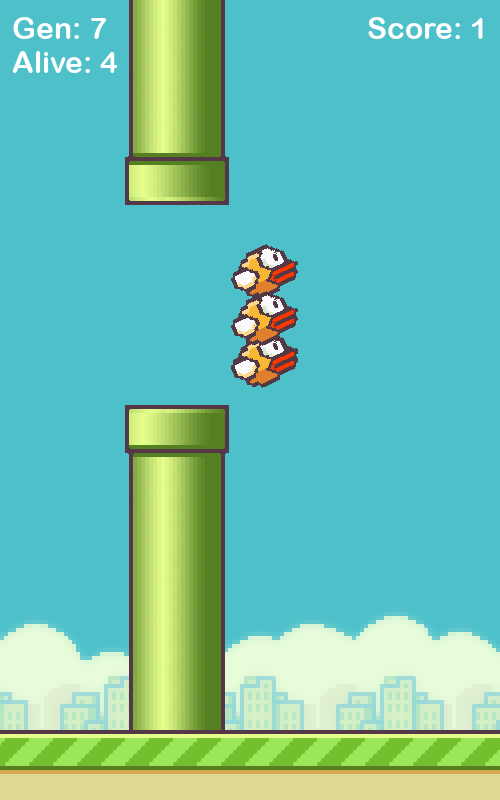

# AI Flappy Bird (NEAT)

A population of birds **teaches itself to play Flappy Bird** with **NEAT** (NeuroEvolution of Augmenting Topologies). Nobody tells them when to flap. Each generation, the birds that survive longest pass their neural networks on, and within a few generations the flock learns to thread the pipes.



## How it works

1. **Population:** each generation starts with 20 birds, and each bird is controlled by its own small neural network (its *genome*).
2. **Senses:** every frame, a bird's network gets 3 inputs: its height, its distance to the top pipe, and its distance to the bottom pipe. It outputs one value through a `tanh` activation, and above 0.5 means *flap*.
3. **Fitness:** a bird gains 0.1 points per frame it stays alive and 5 points per pipe it passes, and loses 1 point when it crashes.
4. **Evolution:** NEAT keeps the fittest genomes, breeds and mutates them (adding or changing connections and nodes), groups them into species to protect new ideas, and runs the next generation.
5. **Result:** the best network is saved to `best_bird.pkl`, and `replay` lets you watch it fly on its own.

All the game rules live in `flappy/world.py`, which runs any number of birds at once and takes a decision function for each one. The NEAT loop in `flappy/ai.py` just plugs the networks in. That keeps the game testable without any AI.

## Run it

```bash
python3 -m venv .venv && source .venv/bin/activate
pip install -r requirements.txt
python main.py train              # watch evolution in real time
python main.py train --fast       # train as fast as the machine allows
python main.py replay             # watch the best bird from the last run
```

`--generations N` sets how long to train (default 50). `--score-limit N` ends a generation once a bird scores N (default 50). You can tune the evolution itself in `NEAT-config.txt` (population size, mutation rates, activation function).

## Tests

```bash
pytest
```

## Tech

Python 3.10+, pygame-ce, neat-python, and pixel-perfect collision with `pygame.mask`.

## Credits

Built while learning NEAT, following Tech With Tim's "AI plays Flappy Bird" tutorial, then restructured and extended (train/replay modes, saved models, tests). The game art comes from the original Flappy Bird and is used here for educational purposes only.
